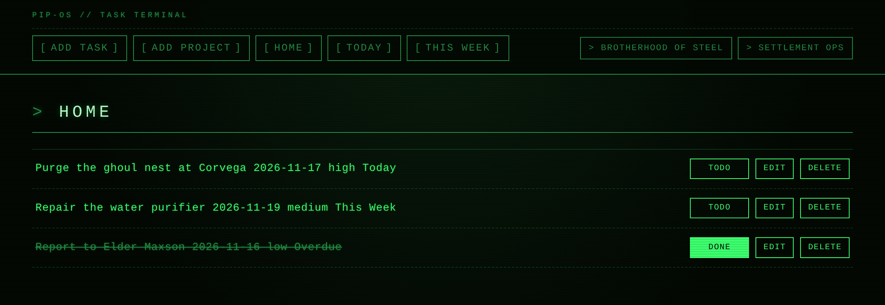

# Todo List

A vanilla JavaScript todo app with projects, task editing, due-date views, and a Fallout-inspired terminal interface. Built with ES modules, Webpack 5, and `date-fns`.

**Live demo:** <https://filipnowakway.github.io/todoList/>



## Features

- **Projects** — create projects, switch between them from the nav, and file tasks under any project.
- **Task management** — name, description, due date, priority; toggle done, edit, or delete.
- **Views** — Home, per-project lists, Today, and This Week.
- **Persistence** — projects and tasks are stored in `localStorage` and restored on reload.
- **Terminal UI** — phosphor-green palette, CRT scanlines, monospace type, and a responsive layout. Styles are split by element in `src/styles/`.

## Getting started

```bash
npm install
npm run dev
```

The dev server runs at <http://localhost:8080>.

## Scripts

| Command          | Description                                 |
| ---------------- | ------------------------------------------- |
| `npm run dev`    | Start the dev server with inline source maps |
| `npm run build`  | Build minified files into `dist/`           |
| `npm run deploy` | Build and publish `dist/` to GitHub Pages   |

## Project structure

```text
src/
├── index.js         application entry point and event wiring
├── template.html    HTML shell used by HtmlWebpackPlugin
├── modules/
│   ├── display.js   DOM rendering and views
│   ├── project.js   Project model and project list
│   ├── storage.js   localStorage load/save helpers
│   └── task.js      Task model and due-date logic
└── styles/
    ├── reset.css
    ├── main.css     theme tokens, base elements, scanlines
    ├── nav.css
    ├── display.css
    ├── tasks.css
    └── forms.css
```

## Data storage

Everything lives in the browser's `localStorage`:

| Key              | Value                              |
| ---------------- | ---------------------------------- |
| `todo.projects`  | JSON array of project names        |
| `<project name>` | JSON array of that project's tasks |

The built-in `defaultProject` is shown as **Home** and does not appear in the project list.

## Requirements

Node.js 22.15 or newer.

## License

MIT — see [LICENSE](./LICENSE).
